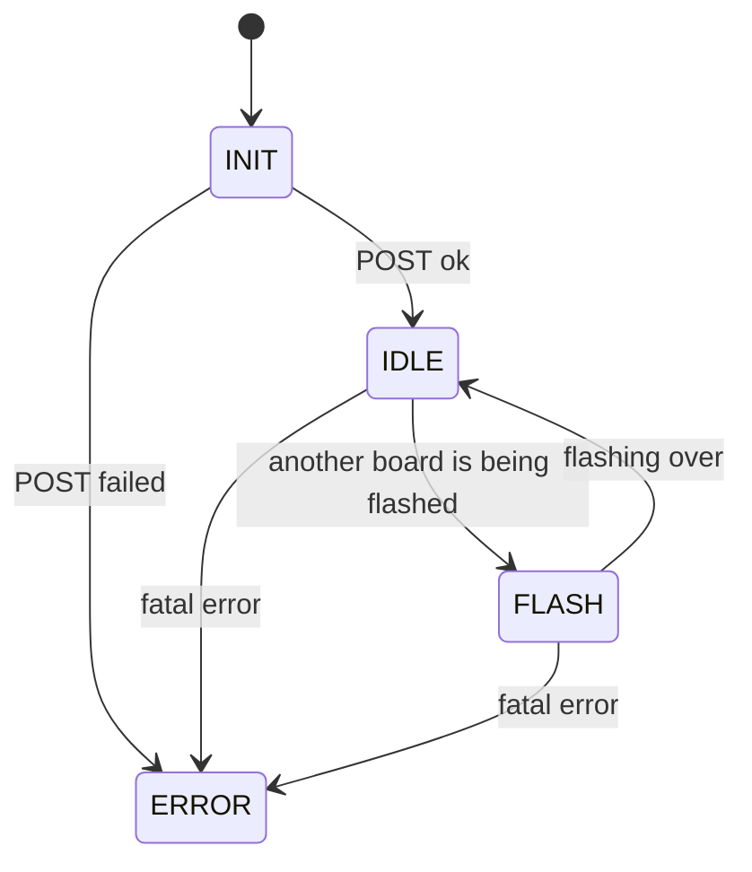

# Steering Wheel - Firmware

Steering wheel firmware of the E-Agle TRT car <em>Fenice Evo</em>, running the **Kraken** steering-wheel codebase ported to this single-core platform.

It works on a **STM32H723ZG** microcontroller placed on a custom PCB.

## Overview

The firmware is responsible for reading data from the **CAN bus** and displaying it on an **800x480 LCD**.
It also handles **buttons** and **3 rotary switches** for user input in real-time, allowing the driver to interact with the system while driving.

## Codebase structure

- `Core/Src/steering/`, `Core/Inc/steering/`: hardware-agnostic application modules (scheduler, FSM, inputs, input events and routing, parameters, CAN communications, dashboard/popup/screen UI).
- `Core/Src/steering/drivers/`, `Core/Inc/steering/drivers/`: hardware-agnostic device drivers (MCP23017 GPIO expander, Micron SDRAM).
- `Core/Src/steering/can-communications-router-api.c`: the only place that knows about **libcan**. It decodes the inbound frames the dashboard renders into the UI snapshot and builds the wheel's own outbound messages (button status carrying TS-on/PTT, control maps, driver action). Identity broadcasts (FSM status, firmware and libcan versions) live in `identity-api.c`.
- Everything else in `Core/` is CubeMX-generated peripheral code; the hardware glue that wires peripherals to the application modules lives in its user-code sections.
- `fenice-evo-steering-wheel-bootloader-sw/`: the OpenBLT CAN bootloader (OpenBLT 1.22, own CubeMX project, built from the same `platformio.ini`). It occupies the first 128K flash sector; the firmware linked after it uses `STM32H723XG_FLASH_SHIFTED.ld` (see [Bootloader](#bootloader)).
- `Core/Src/steering/splash-api.c`: the logo page shared by the firmware's FLASH page and the bootloader screen, so they line up pixel for pixel. The logo is `Core/Src/steering/splash-logo.c`, generated from `assets/eagle-logo.svg` by `tools/generate_logo.py` (needs `rsvg-convert`; run it only when the logo changes).
- `test/`: host unit tests (Unity + fff) for the hardware-agnostic modules.
- `simulator/`: host hooks (window, keyboard, CAN, logger) that run the hardware-agnostic firmware on a PC.
- `Core/Src/steering/wheel-fsm-api.c`: the wheel state machine, built on [libfsm-sw](https://github.com/eagletrt/libfsm-sw) (see below).

## State machine

The wheel FSM is a libfsm-sw table in `wheel-fsm-api.c`, run every 5 ms by the scheduler FSM
task. Any task can request a transition with `wheel_fsm_api_request`; it is applied at the end of
the next FSM step. A requested `ERROR` can't be replaced by a later request.

FLASH follows `flash-monitor-api.c`: every `<Board>FlashingTx/Rx` frame of another board restarts a 500 ms libtimebase watchdog. While it runs, IDLE moves to FLASH; once it
expires, FLASH goes back to IDLE. The wheel's own pair (`0x6E`/`0x6F`) resets it into its bootloader
instead. Board names are in the table at the top of `flash-monitor-api.c`.



| State | What happens | `SteeringWheelFsm.status` |
|---|---|---|
| `INIT` | power-on self test (runs once, before the first task) | `INIT` |
| `IDLE` | dashboard, inputs, CAN; resets into the bootloader when asked | `IDLE` |
| `FLASH` | another board is being flashed: logo, "FLASHING" and the board's name on screen; inputs ignored; `SteeringWheelFsm` is the only frame the wheel sends | `FLASH` |
| `ERROR` | terminal: the last frame stays on screen, CAN keeps reporting the state | `ERROR` |

### Inputs

Raw inputs (button edges, knob steps) go through two layers before they change anything:

- **Input events** (`input-events`): one stream of press / release / long-press / knob events, plus
  **combos**: a set of buttons held together for a hold time. Every hold time is a libtimebase
  watchdog (one per button for the 500 ms long press, one per combo). Long presses and combos fire
  once per hold and again only after a release.
- **Input router** (`input-router`): a table per FSM state. `IDLE` sends the driver controls to the
  parameters and recognises the menu combo; `INIT`, `FLASH` and `ERROR` ignore inputs. Driver
  controls also pass a filter with one flag each for parameters, PTT and TS-on (set by the driving
  context once autonomous missions are handled). Releases always reach the parameters, so a PTT or
  TS-on held while the state or the filter changes is never left on.

Combos (placeholders until the design is ready, `input-events.h`): menu = `TOP_LEFT` +
`TOP_RIGHT`, wake = both bottom paddles, held 1 s. Until the menu exists the menu combo is only
logged. None of these buttons does anything on its own while driving.

## Development

The codebase is based on **PlatformIO**. Install it with `pip install platformio`.

| Environment | What it builds |
|---|---|
| `release` (default) | firmware linked at `0x08000000`, no bootloader (`STM32H723XG_FLASH.ld`) |
| `release-bootloader` | same firmware linked after the bootloader at `0x08020000` (`STM32H723XG_FLASH_SHIFTED.ld`); also writes the OpenBLT checksum and generates `firmware.srec` |
| `bootloader` | the OpenBLT bootloader in `fenice-evo-steering-wheel-bootloader-sw/` |
| `tests` | host unit tests |
| `simulator` | the firmware running on your PC (see below) |

- Build: `pio run` (or `pio run -e <environment>`)
- Flash through SWD (ST-Link, `STM32_Programmer_CLI`): `pio run -e <environment> -t upload`
- Flash over CAN through the bootloader: build `release-bootloader` and flash
  `.pio/build/release-bootloader/firmware.srec` with BootCommander/MicroBoot
- Unit tests: `pio test -e tests`
- Static analysis: `pio check`
- Documentation: `doxygen Doxyfile` (HTML in `docs/html/`)

### Simulator

`pio run -e simulator -t exec` opens a window running the real firmware: same scheduler, task table,
FSM, CAN router and screen as the wheel. Only the hardware is replaced: the dashboard is drawn in the
window, the keyboard is the wheel's inputs, frames the firmware sends are printed (only when their
content changes) and CAN frames can be injected:

| Key | Action |
|---|---|
| `q`/`w`, `a`/`s`, `z`/`x` | manettini (power, regen, torque vectoring) −/+ |
| `e`, `d` | telemetry log, launch control buttons |
| `c`, `v` (hold) | PTT paddles |
| `t` (hold) | TS-on |
| `r`, `f` | top buttons (both 1 s: menu combo, logged) |
| `b`, `n` | bottom paddles (both 1 s: wake combo) |
| `1` | inject `EcuFsm` with the next vehicle status |
| `2` | inject one step of telemetry (SoC, temperatures, laps) |
| `p` | toggle a continuous telemetry feed |
| `3` | toggle flashing traffic of another board (FLASH page, wheel muted) |
| `4` | next board for the flashing traffic |

`--screenshot <file.ppm>` runs for one second, saves the window and exits
(e.g. `.pio/build/simulator/program --screenshot frame.ppm`). `--replay <from> <to>` feeds
telemetry steps `from..to`, alternating with ECU-state-only frames: with `--screenshot`,
`--replay 0 12` and `--replay 12 12` must produce identical images (a quick check that the
copy-free double buffering never leaves a stale box behind).
`--flash <id>` starts with flashing traffic on, from the board whose `FlashingTx` ID is `<id>`
(e.g. `--flash 0x66 --screenshot flash.ppm` for the pedals' FLASH page).
Needs OpenGL (Cocoa on macOS, GL + X11 on Linux).

### Bootloader

- Shows the logo while it waits for a flashing tool, and "FLASHING STEERING WHEEL" under it while
  one is connected (`Core/Src/bootloader-screen.c`, same splash page as the firmware, drawn by the
  CPU with its own small font: `fenice-evo-steering-wheel-bootloader-sw/tools/fonts.json`).
- The OpenBLT signature checksum is the word right after the vector table, at `0x2CC`: reserved by
  `STM32H723XG_FLASH_SHIFTED.ld`, written by `scripts/openblt_image.py`, read by the bootloader
  (`BOOT_FLASH_VECTOR_TABLE_CS_OFFSET` in `blt_conf.h`). Bootloader and firmware must agree: flash
  both after changing it.
- `flash_layout.c` describes the H723's single 1 MB bank (sectors 1–7 for the firmware).

### Git hooks

`hooks/` contains a `pre-commit` hook (clang-format on the staged files in `Core/`) and a
`commit-msg` hook (`<type>: <description>`, type one of feat, fix, docs, style, refactor, perf,
test, chore). Enable them once per clone:

```bash
git config core.hooksPath hooks
```

## Mantainers

- [Bridi Alessandro](https://github.com/bridiro)

## Licence

This repository is released under GNU AFFERO GENERAL PUBLIC LICENSE Version 3. See [LICENSE](./LICENSE) for more details.
