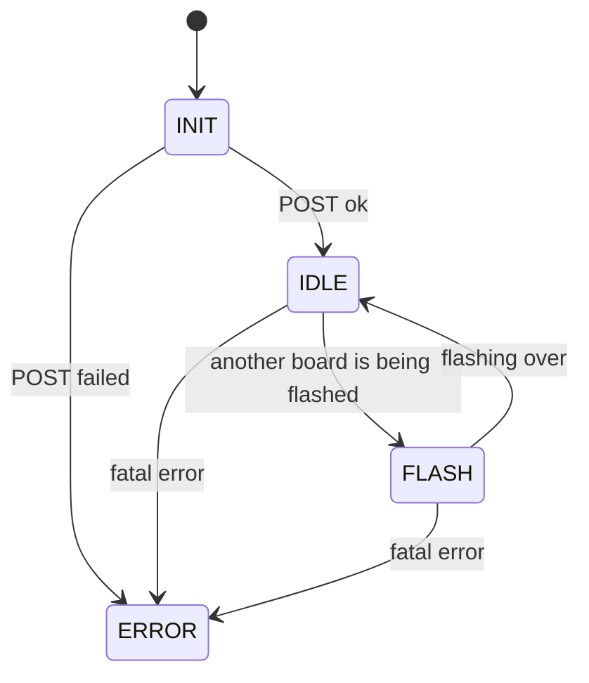

# Steering Wheel - Firmware

Steering wheel firmware of the E-Agle TRT car <em>Fenice Evo</em>, running the **Kraken** steering-wheel codebase ported to this single-core platform.

It works on a **STM32H723ZG** microcontroller placed on a custom PCB.

## Overview

The firmware is responsible for reading data from the **CAN bus** and displaying it on an **800x480 LCD**.
It also handles **buttons** and **3 rotary switches** for user input in real-time, allowing the driver to interact with the system while driving.

## Codebase structure

- `Core/Src/steering/`, `Core/Inc/steering/`: hardware-agnostic application modules (scheduler, FSM, inputs, input events and routing, parameters, CAN communications, dashboard/popup/screen UI).
- `Core/Src/steering/drivers/`, `Core/Inc/steering/drivers/`: hardware-agnostic device drivers (MCP23017 GPIO expander, Micron SDRAM).
- `Core/Src/steering/can-communications-router-api.c`: the only place that knows about **libcan**. It decodes every inbound frame, folds the ones the dashboard renders into the UI snapshot, hands the rest to the flash monitor, and owns the list of identifiers the FDCAN hardware filters let through (everything else is rejected before it reaches the CPU; the secondary bus accepts nothing yet). It also builds the wheel's own outbound messages (button status carrying TS-on/PTT, control maps, driver action). Identity broadcasts (FSM status, firmware and libcan versions) live in `identity-api.c`.
- Everything else in `Core/` is CubeMX-generated peripheral code; the hardware glue that wires peripherals to the application modules lives in its user-code sections.
- `fenice-evo-steering-wheel-bootloader-sw/`: the OpenBLT CAN bootloader (OpenBLT 1.22, own CubeMX project, built from the same `platformio.ini`). It occupies the first 128K flash sector; the firmware linked after it uses `STM32H723XG_FLASH_SHIFTED.ld` (see [Bootloader](#bootloader)).
- `Core/Src/steering/splash-api.c`: the logo page shared by the firmware's FLASH page and the bootloader screen, so they line up pixel for pixel. The logo is `Core/Src/steering/splash-logo.c`, generated from `assets/eagle-logo.svg` by `tools/generate_logo.py` (needs `rsvg-convert`; run it only when the logo changes).
- `test/`: host unit tests (Unity + fff) for the hardware-agnostic modules.
- `simulator/`: host hooks (window, keyboard, CAN, logger) that run the hardware-agnostic firmware on a PC.
- `Core/Src/steering/wheel-fsm-api.c`: the wheel state machine, built on [libfsm-sw](https://github.com/eagletrt/libfsm-sw) (see below).

## State machine

The wheel FSM is a libfsm-sw table in `wheel-fsm-api.c`, run every 5 ms by the scheduler FSM
task. Any task can request a transition with `wheel_fsm_api_request`; it is applied at the end of
the next FSM step. A requested `ERROR` can't be replaced by a later request.

FLASH follows `flash-monitor-api.c`: every `<Board>FlashingTx/Rx` frame of another board restarts a 500 ms timeout. While it runs, IDLE moves to FLASH; once it
expires, FLASH goes back to IDLE. The wheel's own pair (`0x6E`/`0x6F`) resets it into its bootloader
instead, right away and in every state (ERROR included, so a wheel in ERROR can still be reflashed).
Board names are in the table at the top of `flash-monitor-api.c`.



| State | What happens | `SteeringWheelFsm.status` |
|---|---|---|
| `INIT` | power-on self test (runs once, before the first task) | `INIT` |
| `IDLE` | dashboard, inputs, CAN | `IDLE` |
| `FLASH` | another board is being flashed: logo, "FLASHING" and the board's name on screen; inputs ignored; `SteeringWheelFsm` is the only frame the wheel sends | `FLASH` |
| `ERROR` | terminal: the last frame stays on screen, CAN keeps reporting the state | `ERROR` |

### Timeouts

Every timeout of the wheel (flash traffic silence, long presses, the combo window; later CAN data
staleness and acks) comes from one static pool in `timeout-api.c`: a module creates its timeouts at
init and gets ids back (`timeout_api_create/start/stop`), expiry callbacks run from the scheduler's
main loop with the context given at creation. It is built on libtimebase watchdogs, but nothing
else includes libtimebase's watchdog headers. Size: `TIMEOUT_MAX_COUNT` (20, at most libtimebase's
`WATCHDOGS_MAX_COUNT`); a `static_assert` in `scheduler-api.c` checks the wheel's total.

### Inputs

Raw inputs (button edges, knob steps) go through two layers before they change anything:

- **Input events** (`input-events`): buttons and combos produce the same events: press, release,
  tap (released before the long-press time) and long press; knobs produce rotations.
  - A button that belongs to a combo active in the current state opens a **150 ms combo window**.
    If the rest of the combo goes down inside it, the combo is pressed and its buttons send nothing
    of their own; otherwise the button's press is delivered when the window ends (or at once if it
    is released first).
  - A button in no active combo is delivered at once. Long press: 500 ms from the physical press;
    combo long press: 1 s from its recognition.
- **Input router** (`input-router`): one **binding table per FSM state** (`input-router-api.c`):
  button events, combo events and knob rotations are bound to actions (step, toggle or hold a
  parameter, or a request such as opening the menu). The combos a state binds are the only ones
  recognised in it. Every action belongs to a filter group (parameters, PTT, TS-on; requests are
  never filtered) set by the driving context once autonomous missions are handled. Releases always
  let go of what the button held, in every state and through any filter, so a PTT or TS-on is never
  left on.

`IDLE` today: manettini step power / regen / torque vectoring; bottom buttons toggle telemetry log
and launch control; top paddles hold PTT; TS-on held while pressed; **top right = driver action
OK, top left = REPEAT** (1 while held, `DriverAction` on every change); menu combo (both top
buttons, placeholder) held 1 s requests the menu (only logged until the menu exists). `INIT`,
`FLASH` and `ERROR` bind nothing.

### Rendering

Drawing doesn't wait for the DMA2D. On the wheel, libraster's draw callbacks only queue transfers
(`Core/Src/dma2d.c`, on [libring-buffer-sw](https://github.com/eagletrt/libring-buffer-sw)) and return;
the DMA2D interrupt starts the next one, and when the last transfer of a frame has run it swaps the
framebuffers. The application only sees the draw callbacks, the swap and the optional
`SchedulerConfig.render_busy`: while a frame is in flight the render task skips its turn and the
changes wait for the next one, so every render is followed by exactly one swap. The simulator draws
synchronously and leaves the hook NULL.

- A mask is copied into AXI SRAM (`0x24020000`, 192 KB, after libraster's 128 KB scratch at
  `0x24000000`) because libraster reuses its scratch for the next label before the transfer has run.
  The copies are all given back when the queue is empty (a full dashboard takes ~85 KB).
- A failed transfer is counted (`d2d transfer errors` on the UART) and the queue moves on. If a frame
  stays in flight for 500 ms, or the draw path finds no room for 100 ms, the FSM goes to `ERROR`, like
  any other screen failure: the last complete frame stays on screen and the bus reports it.

## Development

The codebase is based on **PlatformIO**. Install it with `pip install platformio`.

| Environment | What it builds |
|---|---|
| `release` (default) | firmware linked at `0x08000000`, no bootloader (`STM32H723XG_FLASH.ld`) |
| `release-bootloader` | same firmware linked after the bootloader at `0x08020000` (`STM32H723XG_FLASH_SHIFTED.ld`); also writes the OpenBLT checksum and generates `firmware.srec` |
| `bootloader` | the OpenBLT bootloader in `fenice-evo-steering-wheel-bootloader-sw/` |
| `tests` | host unit tests |
| `simulator` | the firmware running on your PC (see below) |

- Build: `pio run` (or `pio run -e <environment>`)
- Flash through SWD (ST-Link, `STM32_Programmer_CLI`): `pio run -e <environment> -t upload`
- Flash over CAN through the bootloader: build `release-bootloader` and flash
  `.pio/build/release-bootloader/firmware.srec` with BootCommander/MicroBoot
- Unit tests: `pio test -e tests`
- Static analysis: `pio check`
- Documentation: `doxygen Doxyfile` (HTML in `docs/html/`)

### Simulator

`pio run -e simulator -t exec` opens a window running the real firmware: same scheduler, task table,
FSM, CAN router and screen as the wheel. Only the hardware is replaced: the dashboard is drawn in the
window, the keyboard is the wheel's inputs, frames the firmware sends are printed (only when their
content changes) and CAN frames can be injected:

| Key | Action |
|---|---|
| `q`/`w`, `a`/`s`, `z`/`x` | manettini (power, regen, torque vectoring) −/+ |
| `e`, `d` | telemetry log, launch control buttons |
| `c`, `v` (hold) | PTT paddles |
| `t` (hold) | TS-on |
| `r`, `f` (hold) | top buttons: REPEAT / OK driver actions; both together, held 1 s: menu combo (logged) |
| `b`, `n` | bottom paddles (no function yet) |
| `1` | inject `EcuFsm` with the next vehicle status |
| `2` | inject one step of telemetry (SoC, temperatures, laps) |
| `p` | toggle a continuous telemetry feed |
| `3` | toggle flashing traffic of another board (FLASH page, wheel muted) |
| `4` | next board for the flashing traffic |

`--screenshot <file.ppm>` runs for one second, saves the window and exits
(e.g. `.pio/build/simulator/program --screenshot frame.ppm`). `--replay <from> <to>` feeds
telemetry steps `from..to`, alternating with ECU-state-only frames: with `--screenshot`,
`--replay 0 12` and `--replay 12 12` must produce identical images (a quick check that the
copy-free double buffering never leaves a stale box behind).
`--flash <id>` starts with flashing traffic on, from the board whose `FlashingTx` ID is `<id>`
(e.g. `--flash 0x66 --screenshot flash.ppm` for the pedals' FLASH page).
Needs OpenGL (Cocoa on macOS, GL + X11 on Linux).

### Bootloader

- Shows the logo while it waits for a flashing tool, and "FLASHING STEERING WHEEL" under it while
  one is connected (`Core/Src/bootloader-screen.c`, same splash page as the firmware, drawn by the
  CPU with its own small font: `fenice-evo-steering-wheel-bootloader-sw/tools/fonts.json`).
- The OpenBLT signature checksum is the word right after the vector table, at `0x2CC`: reserved by
  `STM32H723XG_FLASH_SHIFTED.ld`, written by `scripts/openblt_image.py`, read by the bootloader
  (`BOOT_FLASH_VECTOR_TABLE_CS_OFFSET` in `blt_conf.h`). Bootloader and firmware must agree: flash
  both after changing it.
- `flash_layout.c` describes the H723's single 1 MB bank (sectors 1–7 for the firmware).

### Git hooks

`hooks/` contains a `pre-commit` hook (clang-format on the staged files in `Core/`) and a
`commit-msg` hook (`<type>: <description>`, type one of feat, fix, docs, style, refactor, perf,
test, chore). Enable them once per clone:

```bash
git config core.hooksPath hooks
```

## Mantainers

- [Bridi Alessandro](https://github.com/bridiro)

## Licence

This repository is released under GNU AFFERO GENERAL PUBLIC LICENSE Version 3. See [LICENSE](./LICENSE) for more details.
